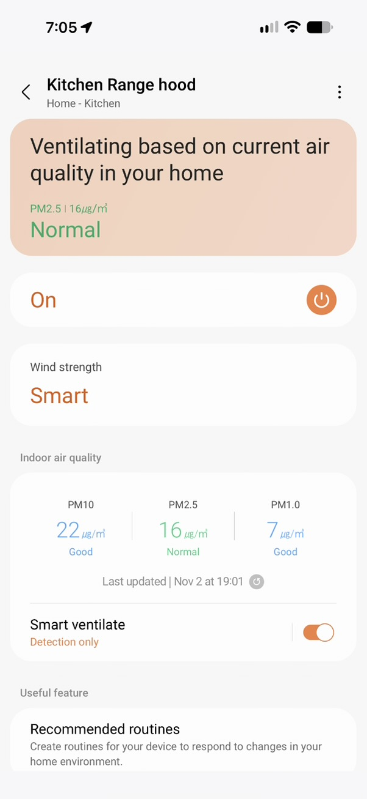
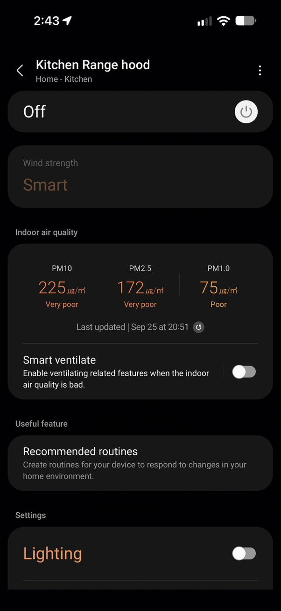

# Range-hood air quality and Smart ventilate

Observed on AHD-WW-TP1-22-COMMON. These observations apply to this hood;
other Samsung families use different quality vocabularies.

SmartThings displays these concentrations and grades:

| PM10 | PM2.5 | PM1.0 |
|---|---|---|
| 22 µg/m³ — Good | 16 µg/m³ — Normal | 7 µg/m³ — Good |
| 225 µg/m³ — Very poor | 172 µg/m³ — Very poor | 75 µg/m³ — Poor |

The screenshots establish the app wording and units. Earlier paired local
observations established grade codes 1/2/3/4 as Good/Normal/Poor/Very poor;
these screenshots alone do not establish the numeric codes or thresholds.
Concentration sensors keep their existing Dust, Fine dust and Super fine dust
names and keys; separate enum sensors expose the reported grades.

During two observed sensing cycles, all three particle grades became 10.
Direct captures included Dust [25,10], FineDust [21,10] and SuperFineDust [11,10].
Normal grades returned within about 14 seconds. A recorder sequence changed
Good/Normal/Good → Processing → Good/Normal/Good between 23:32:47 and 23:32:59.
The separate sensing-state flag could return to NonProcessing roughly one second
before valid grades returned, so grade 10 itself maps to Processing.
This is a local observation rather than a universal Samsung specification.

The app calls the feature Smart ventilate and offers Quietly ventilate,
Get notifications and Detection only. This board accepts Sensing for Detection
only despite advertising just Airpurify and Alarm. Writes were verified locally;
other boards have not been verified for the unadvertised option.

This hood stores the daily do-not-disturb window in UTC. If the app/device
leaves it unchanged across daylight saving, the local hours shift. Re-entering
the desired hours updates the UTC window; integration reload does not.
App/device seasonal adjustment has not been verified.

Review revision (#794): the unadvertised Sensing option is restricted to the
verified board or advertised/reported support. An unset DND window
(`00000000`) shows unknown. Edits use one offset from the next local start
date for both endpoints, preserving window length through a DST change;
this does not remove seasonal drift of a previously stored UTC schedule.
